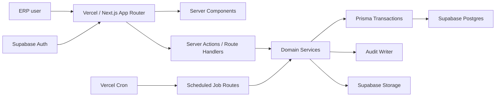

# Technical Blueprint

## Architecture Choice

Artmonia ERP should be built as a Vercel-hosted full-stack modular monolith.

The frontend, backend routes, server actions, domain services, and scheduled jobs live in one Next.js application. Supabase provides managed Postgres, Auth, Storage, and future realtime/integration options.

This gives the project a fast MVP path while preserving clean module boundaries for later growth.



## Runtime Responsibilities

### Next.js App

- Authenticated ERP shell
- Role-based navigation
- Dashboard and list rendering
- Server-side data loading
- Mutations through server actions or route handlers
- API endpoints for future website lead capture and integrations

### Domain Services

Domain services are the only place where business-critical mutations happen.

Initial modules:

- `auth` - session, profile, roles, permission checks
- `admin` - users, roles, lookups, settings
- `crm` - leads, stages, follow-up, conversion
- `students` - profiles, lifecycle, relationships, status history
- `programs` - catalog, pricing versions, enrollment defaults
- `billing` - invoices, payments, allocations, debt, advance, refund requests
- `teachers` - profiles, contract rules, payout calculations
- `dashboards` - KPI queries, snapshots, drill-down data
- `tasks` - manual and automated work queue
- `audit` - critical before/after logging
- `migration` - seed data and future Excel dry-run/final import

### Supabase

Supabase should be used as infrastructure, not as an uncontrolled client-side data layer.

- Supabase Auth handles identity.
- Internal ERP users map to Supabase auth users through `auth_user_id`.
- Supabase Postgres stores domain data.
- Supabase Storage stores receipts, exports, and student files.
- Critical ERP writes are server-controlled.
- Browser code must not receive service role or secret keys.

### Prisma

Prisma should be used for:

- Typed domain transactions
- Payment allocation consistency
- Invoice and payroll state changes
- Seed/demo data
- Migration-friendly schema management

Raw SQL should be allowed for:

- Dashboard views
- Materialized KPI snapshots
- Complex reporting queries
- Bulk import validation reports

Implementation note for Prisma 7:

- Use the `prisma-client` generator with an explicit output path.
- Keep datasource URLs in `prisma.config.ts`, not in `schema.prisma`.
- Use the Postgres driver adapter for runtime Prisma Client creation.
- Use the pooled Supabase `DATABASE_URL` at runtime and direct `DIRECT_URL` for CLI migrations.

## Recommended Repo Structure

```text
artmonia-erp/
  src/
    app/
      (auth)/
      (erp)/
      api/
        cron/
        webhooks/
    components/
      ui/
      layout/
      data-table/
    modules/
      admin/
      audit/
      auth/
      billing/
      crm/
      dashboards/
      migration/
      programs/
      students/
      tasks/
      teachers/
    server/
      db/
      env/
      errors/
      rbac/
      supabase/
    styles/
  prisma/
    schema.prisma
    seed.ts
  database/
    schema-blueprint.sql
  docs/
```

## Data Access Pattern

Use three access levels:

1. Public/browser-safe Supabase client for auth/session-only browser operations.
2. Server Supabase client for session validation and storage operations.
3. Prisma server database client for ERP domain transactions.

No browser component should directly mutate ERP tables.

## Routing Pattern

- Server Components load read models for pages.
- Server Actions handle form mutations where the response updates the current view.
- Route Handlers handle API-style calls, webhooks, cron jobs, export downloads, and integration endpoints.
- Heavy modules are lazy-loaded behind route segments.

Example route map:

```text
/(erp)/dashboard
/(erp)/today
/(erp)/crm
/(erp)/students
/(erp)/students/[id]
/(erp)/finance/payments
/(erp)/finance/debt
/(erp)/teachers
/(erp)/reports
/(erp)/settings
/api/cron/invoice-generation
/api/cron/overdue-calculation
/api/cron/payment-reminders
/api/webhooks/lead-capture
```

## Scheduled Jobs

MVP jobs:

- `invoice_generation_job` - creates monthly invoices for active enrollments
- `overdue_calculation_job` - updates overdue state and aging buckets
- `payment_reminder_job` - creates tasks for 3/7/14/21 day overdue cases
- `freeze_return_job` - creates return tasks for frozen students
- `group_waiting_job` - creates tasks for students waiting more than 7 days
- `dashboard_snapshot_job` - stores daily/monthly KPI snapshots
- `backup_audit_job` - records backup/export checks

Jobs should be idempotent. Every job run should write a job log with status, started time, finished time, affected rows, and error message when applicable.

## Key Implementation Rules

- Use database transactions for lead conversion, payment allocation, refund approval, status changes, and payroll approval.
- Add optimistic UI only after server mutation contracts are stable.
- Use idempotency keys for payment creation/import and invoice generation.
- Keep all monetary values as integer minor units or fixed decimal with explicit currency. Recommended: `numeric(12,2)` for AZN in Postgres, validated in code.
- Keep all important dates timezone-aware where timestamps are needed; use plain `date` for billing periods and due dates.
- Use Vercel Cron only for lightweight scheduled route triggers. Move to a worker if job duration/load grows.
